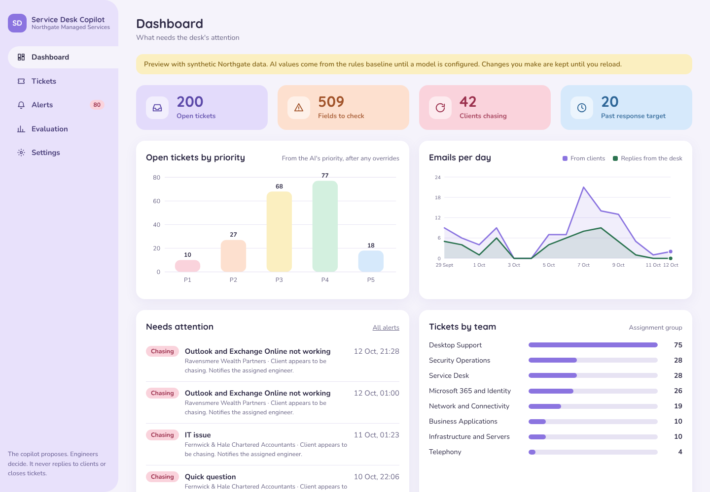
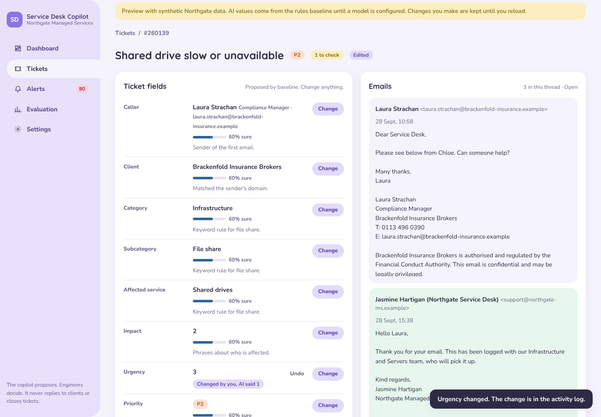
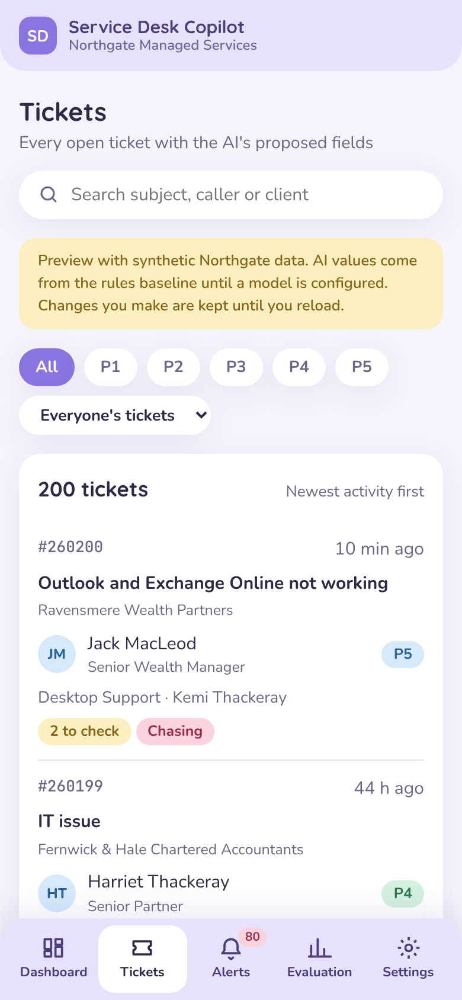
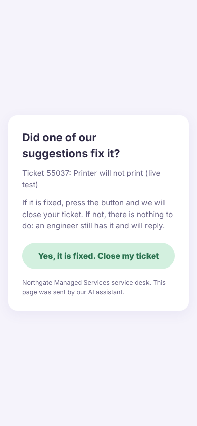

# Service Desk Copilot

An open-source AI assistant for MSP service desks that takes ticket admin off engineers at every tier. It reads clients' emails and:

1. **Fills in the ticket**: caller, client, category, subcategory, affected service, impact, urgency, priority, assignment group and short description, each with a confidence score and a one-line reason. Fields it is unsure of are flagged for a person, not guessed.
2. **Writes a structured note**: what was reported, who is affected, what the client tried, what they are asking for, any deadline, and open questions. Every item is backed by the client's own words; anything missing becomes a question.
3. **Keeps the ticket up to date** on every new email and on a schedule, giving a reason for each change.
4. **Spots clients chasing** ("any update?", resends, rising frustration, but not "no rush") and tickets past their response target, alerting the engineer in Microsoft Teams and escalating to the team lead.
5. **Optionally suggests a few safe steps** to the client while an engineer has the ticket, clearly labelled as AI, with a button the client can press to say it worked.

Engineers stay in control: every AI value can be changed or undone, the copilot leaves a changed field alone, and everything is in an audit log.

Everything runs on synthetic data for a fictional MSP, **Northgate Managed Services**. The repository contains no real company, client or employee data.

| Dashboard | Ticket | On a phone |
|---|---|---|
|  |  |  |

## Quick start

You need Docker and [uv](https://docs.astral.sh/uv/).

```bash
cp .env.example .env                        # then change the passwords
docker compose up -d --wait                 # the copilot, Postgres, Zammad and Mailpit
uv sync
uv run python scripts/bootstrap_zammad.py   # admin user, email channel, copilot fields, API token
```

Then open:

- the copilot: http://localhost:8000 (synthetic demo tickets until you switch to Zammad, below)
- Zammad: http://localhost:8080
- Mailpit: http://localhost:8025

### Use it on Zammad

1. Put the token the bootstrap script printed in `ZAMMAD_TOKEN`, and set `COPILOT_SOURCE=zammad` in `.env`.
2. Add a model: `LLM_MODEL` and `LLM_API_KEY` (or `LLM_API_BASE` for a local Ollama server). Without one, the copilot uses the rules baseline.
3. `docker compose up -d` again, then send some client emails:

```bash
uv run python scripts/seed_mailpit.py --limit 20   # or no --limit for all 200 dev threads
```

Mail to `support@northgate-ms.example` through Mailpit (SMTP on port 1025) becomes a Zammad ticket. Every `CHECKIN_INTERVAL_MINUTES` the copilot fills in the "Copilot:" fields on each ticket, adds an internal note, and raises alerts. Set `TEAMS_WEBHOOK_URL` (a Teams "Post to a channel when a webhook request is received" workflow) to get alerts in Teams.

### Bring your own AI

The copilot calls models through [LiteLLM](https://docs.litellm.ai/), so the MSP chooses the provider: Anthropic, OpenAI, Azure OpenAI, Google, AWS Bedrock, or a local model through Ollama. Set `LLM_MODEL` (for example `anthropic/claude-haiku-5-5`, the default) and `LLM_API_KEY` in `.env`. The key is never logged or sent to the browser. `SPEND_CAP_USD` and `RATE_LIMIT_PER_MINUTE` keep costs down.

## Evaluation

The evaluation harness is the centrepiece. One command scores every system on the labelled synthetic threads:

```bash
uv run python -m copilot.evaluation               # dev split
uv run python -m copilot.evaluation --judge       # also a model-graded check of notes and suggestions
uv run python -m copilot.evaluation --split test  # the held-out split, for reporting only
```

It measures field accuracy, note faithfulness and completeness, check-in updates, chase detection, alert precision and recall, suggestion safety, PII leakage and cost per ticket, against a rule-based baseline. On the held-out test split the baseline gets 73% of fields right and its alerts are 69% precise. The redactor lets no labelled personal detail through while keeping 98% of other details. The copilot's own scores need an API key; see [`docs/evaluation.md`](docs/evaluation.md) and [`MODEL_CARD.md`](MODEL_CARD.md).

## AI suggestion emails

Off by default. When switched on, a new ticket's client gets one email, written by AI and labelled as such, with two to four safe steps to try while the named team has the ticket. It is never sent for P1 or P2, security, account access, lost device or request tickets, when the AI is unsure of the routing, or when the email looks like it is trying to instruct the AI. The steps are checked before sending (no links, no requests for passwords, codes or personal details, nothing needing admin rights) and the email is dropped if they fail.

The email carries a signed, single-use link. It opens a page with a button, and only pressing it closes the ticket, so mail scanners cannot. The close is logged as the client's, the engineer is told, and the ticket reopens if the client writes again or the engineer reopens it. The dashboard shows how many suggestions clients marked as fixes.

To switch it on, set `SUGGESTIONS_ENABLED`, `SUGGESTION_CLIENTS`, `SUGGESTION_EMAIL_TRANSPORT=smtp`, `SUGGESTION_LINK_SECRET` and `PUBLIC_URL`, then run `uv run python -m copilot.evaluation --judge` with your model. Nothing is sent until that run shows no suggestions drafted for tickets that must be skipped and the judge rates at least 98% of them safe.



## Privacy and security

Names, email addresses, phone numbers, account numbers and other personal details are replaced with placeholders such as `[PERSON_1]` before any text reaches a model, using Microsoft Presidio, UK-specific patterns and the MSP's own contact list ([`docs/redaction.md`](docs/redaction.md)). Email text is passed to the model as fenced, untrusted data, never as instructions. See [`SECURITY.md`](SECURITY.md).

## Deploying the demo

[`docs/deploy.md`](docs/deploy.md) runs the stack on a small VPS behind a Cloudflare Tunnel, with Cloudflare Access in front of the admin pages.

## Development

```bash
uv run pytest                                  # tests (no stack, no model needed)
uv run pytest -m compose                       # tests against the running stack
uv run ruff check . && uv run ruff format --check .
uv run uvicorn copilot.web.app:app --reload    # the screens, outside Docker
uv run python scripts/export_ui_preview.py     # the screens as one HTML file
```

GitHub Actions runs linting, the synthetic data validator, the tests and the held-out evaluation on every push, plus a job that brings up the whole compose stack and checks that an email becomes a Zammad ticket. See [`CLAUDE.md`](CLAUDE.md) for how the code is organised and the rules contributors follow, and [`datagen/README.md`](datagen/README.md) for how the synthetic emails are made.

## Licence

MIT. See [LICENSE](LICENSE).
